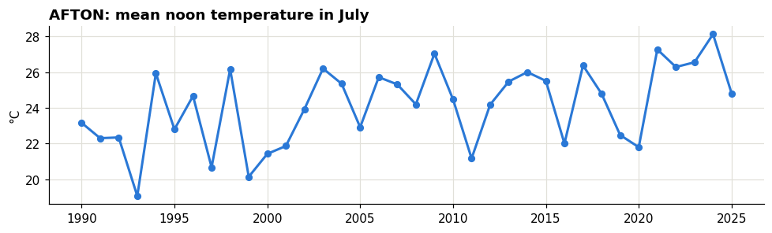
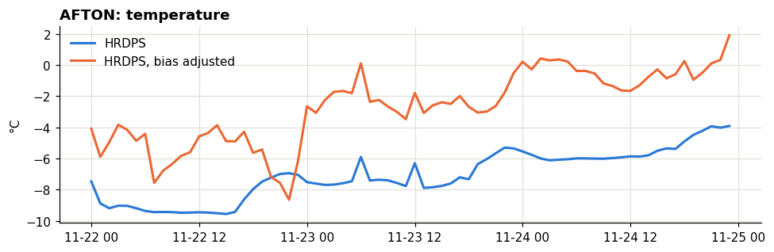
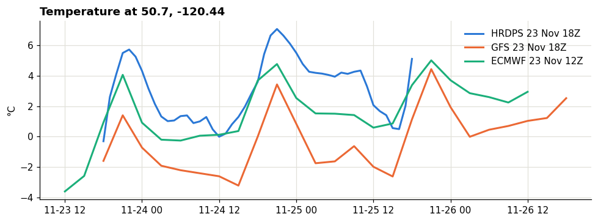
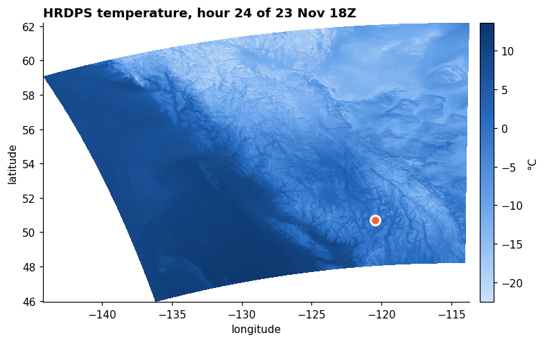

<!-- _paginate: false -->

# Requesting weather data

Station data from the API, and model maps from storage

November 2026

<!--
The results shown were requested on November 23 from the development environment.
-->

---

## Two ways in

| | Station data | Model maps |
|---|---|---|
| How | Station Weather API | `GridStore` Python library |
| What you need | An API key | The object storage settings |
| Where | At weather stations | Anywhere in BC |
| What | Observations, forecasts, model values | HRDPS, RDPS, GDPS, GFS, ECMWF |

There is no API for the maps yet.

---

## What the API has

| Path | Gives |
|---|---|
| `/stations` | Every station, with its code and location |
| `/observations/daily`, `/observations/hourly` | Observations, back to 1987 |
| `/forecasts/daily` | Forecasters' noon forecasts |
| `/models/HRDPS/daily`, `/models/HRDPS/hourly` | Model values at the station, as published and bias adjusted |

Daily means the noon record (20:00 UTC). Observations include the FWI indices.

With no dates: the last 7 days of observations, or the next 10 days of forecasts and model values.

<!--
HRDPS can be replaced with GDPS, RDPS, GFS or ECMWF.
In November the FWI indices were empty for the two stations used here.
-->

---

## A request

```python
import os
import requests

API = "https://psu-pr-6073-api-gov-bc-ca.test.api.gov.bc.ca/api/weather/v1"

response = requests.get(
    f"{API}/observations/daily",
    params={"station_codes": "322,209", "start": "2026-11-17", "end": "2026-11-23"},
    headers={"X-API-Key": os.environ["WEATHER_API_KEY"]},
)
rows = response.json()["rows"]
```

- Stations are codes, separated by commas
- The key comes from the environment, so it isn't saved in the notebook

<!--
This is the development address.
-->

---

## What comes back

| Station | Time (UTC) | Temp | RH | Wind | Precip |
|---|---|---|---|---|---|
| 322 | 2026-11-20 20:00 | -1.5 | 80 | 3.1 | 0.0 |
| 322 | 2026-11-21 20:00 | -2.7 | 90 | 2.8 | 0.0 |
| 322 | 2026-11-22 20:00 | -1.7 | 81 | 10.9 | 0.0 |
| 322 | 2026-11-23 20:00 | 2.0 | 72 | 18.6 | 0.0 |

- JSON, or CSV with the header `Accept: text/csv`
- Long requests come in pages. `next` in the response is the address of the next page
- 60 requests a minute for each key. After that the answer is 429, so wait and try again
- A wrong request gets a 422 that says why, such as `end is before start`

<!--
Station 322 is Afton. Other columns were left out.
-->

---

## A long history



36 years of daily observations at Afton (11,722 rows) in one request.

---

## Model values at a station



Each value comes with the run it is from.

---

## Every model, noon temperature at Afton (°C)

| | GDPS | RDPS | HRDPS | GFS | ECMWF |
|---|---|---|---|---|---|
| Nov 23 | -3.5 | -4.6 | -6.0 | -3.5 | -4.1 |
| Nov 24 | -0.9 | -2.3 | -4.2 | -0.8 | -1.7 |
| Nov 25 | 1.6 | 0.5 | | 0.1 | 0.2 |
| Nov 26 | 3.0 | 3.2 | | -0.1 | 0.3 |
| Nov 27 | 0.3 | | | 0.7 | -0.1 |

HRDPS and RDPS forecast fewer days ahead.

<!--
As published, not bias adjusted. GDPS, GFS and ECMWF continue to December 2.
-->

---

## Reading the maps

```python
from wps_weather_data.grids.store import GridStore

store = GridStore("HRDPS", "recent")       # or "history"
run = store.run_times()[-1]                # the newest run

y, x = store.nearest_cell(50.70, -120.44)  # Kamloops
point = store.read_point(run, y, x)        # one place, every hour

field = store.read_map(run, 24, "temperature")  # all of BC, one hour
```

- `recent` is every run for 48 hours, `history` is one run a day
- Set `SUFFIX` first. Without it the library uses production's location
- Check `store.exists()`, because opening a store that isn't there creates it

---

## A forecast anywhere in BC



Three models at Kamloops, 50.70, -120.44. No station is needed.

<!--
Times are UTC. On November 23 one point took 1.5 s to read from a laptop. It has not been timed inside the cluster.
-->

---

## A map



HRDPS temperature over BC. The marker is Kamloops.

<!--
On November 23 this took 4.2 s to read from a laptop. Maps read more of the store than points do, so they are slower.
-->

---

## Units differ between models

The maps hold what each centre published.

| | HRDPS, RDPS, GDPS | GFS | ECMWF |
|---|---|---|---|
| Temperature | kelvin | kelvin | kelvin |
| Wind | speed and direction | u and v | u and v |
| Humidity | relative humidity | relative humidity | dew point |
| Precipitation since the run started | mm | mm | metres |

`point_forecast` in the notebook converts them all to °C, %, km/h and mm.

---

## Checking one against the other

HRDPS at Afton, from the maps and from the API:

| Time (UTC) | Maps | API |
|---|---|---|
| Nov 23 18:00 | -7.3 | -7.3 |
| Nov 23 19:00 | -6.4 | -6.4 |
| Nov 23 20:00 | -6.0 | -6.0 |
| Nov 23 21:00 | -5.7 | -5.7 |

Over 49 hours the largest difference was 0.0 °C, to one decimal.

<!--
They won't always match: they can be from different runs, and the maps give the nearest grid cell.
-->
