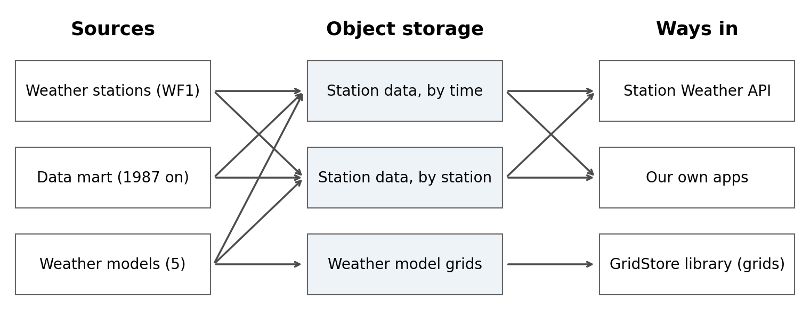
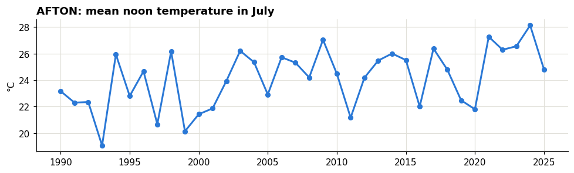
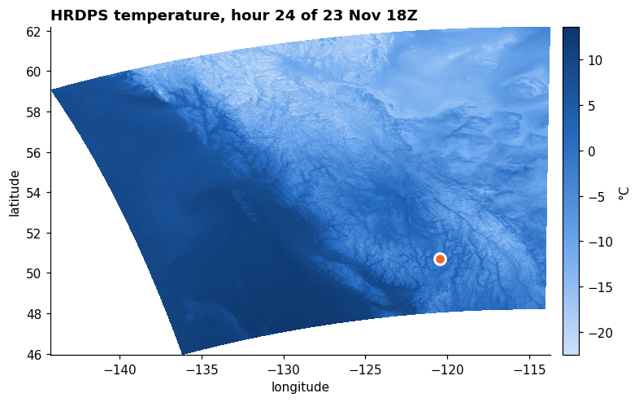
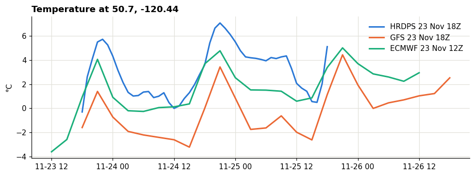
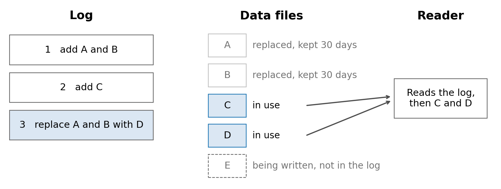
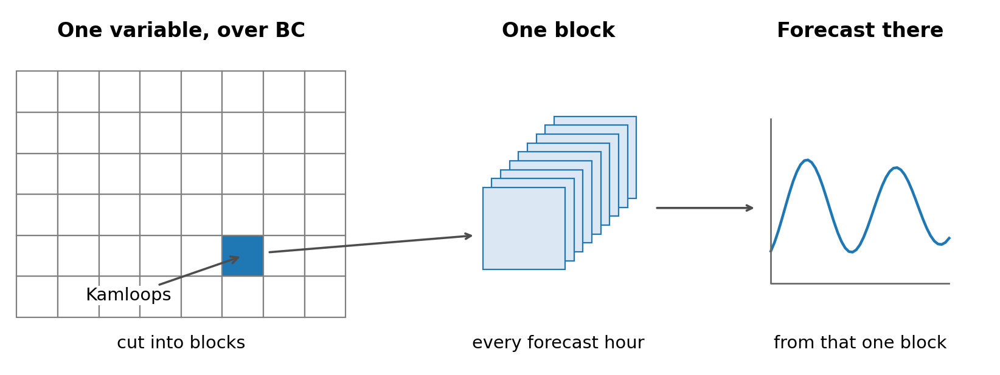
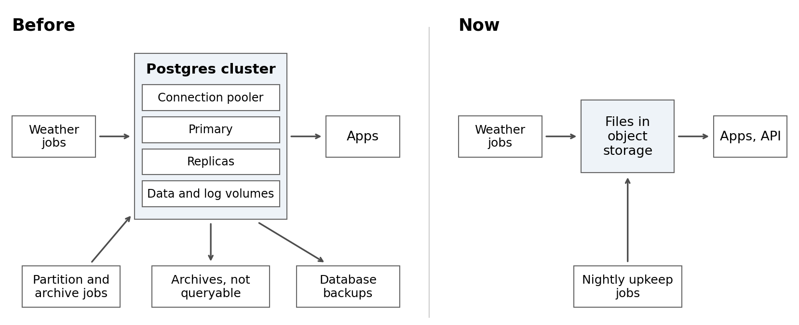
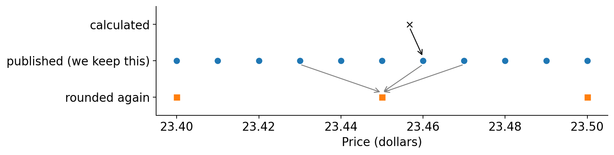

<!-- _paginate: false -->
<!-- _class: title -->

# Unlocking our weather data

Keeping it, and making it easy to build on

November 2026

<!--
Everything here is running in development. Production has not been moved yet.
-->

---

## We had to keep pruning

Weather data was kept in our Postgres database, where storage space is limited.

- Model data more than a few months old was archived to make room, and couldn't be looked at without restoring it
- Forecasts were only kept at weather stations
- Looking back over past seasons was hard, because the history wasn't there to query

<!--
The archive jobs existed only to manage the size of the database.
-->

---

## Moving it somewhere we can keep it

1. Moved station weather out of Postgres into object storage, which is cheap enough to keep all of it
2. Started keeping weather model grids over BC, not only the values at stations
3. Arranged the data for the questions people ask, so a request reads only what it needs
4. Put an API on the station data, and a library on the weather model grids

---

## From source to app



Forecasts entered in MoreCast stay in Postgres.

<!--
Our own apps are MoreCast, fire watch and the climatology page. They read the station data directly.
The weather model grids are not in the API yet, and no app reads them yet.
-->

---

## What we can reach now

| | Before | Now |
|---|---|---|
| Observations | Since our own job started collecting them | Hourly, back to 1987 |
| Model data | The last few months | Every run, from now on |
| Where | At weather stations | Anywhere in BC, for five models |
| New stations | No model history | History from the weather model grids, from November 2026 |

<!--
The five models are HRDPS, RDPS and GDPS (Canadian), GFS (American) and ECMWF (European).
-->

---

## 36 years of Julys at Afton



July at Afton since 1990. 36 years of daily observations, in one request to the API.

<!--
11,722 rows. The climatology page goes further, and compares this year with every other year, day by day.
-->

---

## A forecast for all of BC



An HRDPS forecast, read from storage. The marker is Kamloops.

---

## Any model, anywhere



Three models at one point. It doesn't need a station, so it could be a fire.

<!--
Kamloops, 50.70, -120.44. Times are UTC.
-->

---

## Arranged for the questions we ask

| Question | Arranged by | What has to be read |
|---|---|---|
| This station, over decades | Station and year | About one file a year |
| Every station, this week | Time | About one file for each source and month |
| The forecast at this place | Blocks of the grid, with every hour | One block for each variable |

The station data is stored twice, because one arrangement can't be good at both questions. Storage is cheap enough to do that. The weather model grids are arranged for reading one place, so reading all of BC takes longer.

---

## Delta Lake: a log of which files count



Station data is ordinary files, plus a log of which ones count. A write is finished when it is in the log, so a reader never sees half of one.

<!--
Replacing A and B with D is what the nightly compaction does: many small files become one.
The replaced files are kept for 30 days, so a table can be read as it was at any point in that time.
Two jobs can't write the same log entry. The second one has to try again or fail.
Each table has its own log, so a write to two tables is two separate steps.
-->

---

## Zarr: a grid we can read block by block



Weather model grids are cut into blocks that can be read on their own. Icechunk adds a history to Zarr, so a model run appears all at once or not at all.

<!--
The picture is not to scale, and the line is only an illustration.
A block is 64 by 64 grid cells with every forecast hour. There is one for each variable.
Reading all of BC for one hour means reading every block, which is why that takes longer.
-->

---

## A whole record in one request

```python
import os
import requests

API = "https://psu-pr-6073-api-gov-bc-ca.test.api.gov.bc.ca/api/weather/v1"

response = requests.get(
    f"{API}/observations/daily",
    params={"station_codes": "322", "start": "1990-01-01", "end": "2025-12-31"},
    headers={"X-API-Key": os.environ["WEATHER_API_KEY"]},
)
rows = response.json()["rows"]
```

This is the request behind the July chart. There is no database account and no file to download.

<!--
This is the development address. It works from any language that can make a web request.
-->

---

## The API handles the details

- With no dates you get the last 7 days of observations, or the next 10 days of forecasts
- The same address gives CSV or JSON
- Long requests come in pages, and each page has the address of the next
- Errors say what is wrong, such as `end is before start`
- Model values come with bias-adjusted values and the run they are from

Stations, observations, forecasters' forecasts and model values all work the same way.

<!--
60 requests a minute for each key.
-->

---

## A model grid in a few lines

```python
from wps_weather_data.grids.store import GridStore

store = GridStore("HRDPS", "recent")
run = store.run_times()[-1]                     # the newest run

y, x = store.nearest_cell(50.70, -120.44)       # Kamloops
point = store.read_point(run, y, x)             # one place, every hour

field = store.read_map(run, 24, "temperature")  # all of BC, one hour
```

The same calls work for all five models. There is no API for the grids yet.

<!--
Set SUFFIX first. Without it the library uses production's location.
Check store.exists(), because opening a store that isn't there creates it.
-->

---

## What this makes possible

Already built on it: climatology page, Station Weather API, MoreCast and fire watch

Ideas it opens up:

- The forecast at a fire, not at the nearest station
- How well each model has done at a place, checked against what happened
- A new station that has model history on its first day
- Other teams' tools and dashboards, without another copy of the data

<!--
The ideas are not planned work.
-->

---

## What we have checked so far

- The weather model grids hold exactly what the forecast centre published
- Compared with the old database, 6,936 model values for 320 stations had no differences
- HRDPS at Afton from the grid and from the API was 0.0 °C apart over 49 hours
- When an observation or forecast is corrected, we keep both versions
- A job that stops part way is continued by the next one

<!--
The database check was MoreCast's model read in development on November 16, over 14 days.
0.0 is to one decimal, for the same run.
-->

---

## Files instead of a database



We may lose some speed, but for weather data we only deal with files.

<!--
This is the weather data only. MoreCast's own data stays in Postgres, so that cluster and its backups stay, but the cluster no longer has to hold weather history.
The weather model jobs no longer use the database at all.
The upkeep jobs compact and clean up the files, and rebuild the by-station tables.
The files' speed has not been compared fairly with the database's.
-->

---

## What gets easier, and what is new

| Less to worry about | New to look after |
|---|---|
| Weather history won't grow our database | This data depends on object storage |
| No monthly partition and archive jobs | Nightly jobs to compact and clean up |
| History can be read without a database | Tables can't be updated together in one step, so jobs have to recover |
| Open formats that other tools can read | Newer libraries, which we know less well |
| Tables made from the original records can be rebuilt | Two jobs writing one table at once is only partly tested |

Production still uses the old system until it is moved.

<!--
We haven't run it long enough to say it is more stable.
On November 23 the HRDPS grid store stopped accepting data for about 12 hours and we don't know why. Station model jobs also ran out of memory while publishing, which has been fixed.
The original records are the model runs and the WF1 observations and forecasts. They are added to and never replaced.
-->

---

## About \$44 a year for each year kept

| Weather model grids, per year, five models | |
|---|---|
| Original files, one run a day | about 1 TB |
| BC only, every run | about 200 GB |
| **BC only, what we keep** | **about 52 GB** |

We keep every run for 48 hours, then one run a day.

That is about \$44 a year for each year of grids, at 7 cents per GB per month. Deleted grids stay for 60 days, which is an estimated \$27 a year more if we are billed for it.

<!--
This is for the weather model grids only. It does not include the station data.
-->

---

## Where we are, and what is next

In development, as of November 23: station data, observations to 1987, climatology page, API, and weather model grids from all five models (GDPS, GFS and ECMWF were added that day)

Next:

- Copy production's history over and switch production
- An API for the weather model grids, and a way to view them
- Measure read times inside the cluster
- Find out why the HRDPS 48-hour store stopped accepting data for about 12 hours on November 23. It can no longer hold up the permanent one

<!--
MoreCast and fire watch should work as before. The old database tables stay until production's history has been copied and checked.
-->

---

## Appendix: what is in the API

| Path | Gives |
|---|---|
| `/stations` | Every station, with its code and location |
| `/observations/daily`, `/observations/hourly` | Observations, back to 1987, with FWI indices |
| `/forecasts/daily` | Forecasters' noon forecasts |
| `/models/HRDPS/daily`, `/models/HRDPS/hourly` | Model values at the station. Also GDPS, RDPS, GFS, ECMWF |

Daily means the noon record (20:00 UTC).

---

## Appendix: units in the grids

| | HRDPS, RDPS, GDPS | GFS | ECMWF |
|---|---|---|---|
| Temperature | kelvin | kelvin | kelvin |
| Wind | speed and direction | u and v | u and v |
| Humidity | relative humidity | relative humidity | dew point |
| Precipitation since the run started | mm | mm | metres |

---

## Appendix: why nothing is rounded away



Forecast centres round once, and publish whole-number steps. We store those same steps:

$$\text{value} = \frac{R + X \cdot 2^E}{10^D}$$

Rounding again is like only having nickels: 23.43, 23.46 and 23.47 all become 23.45.
