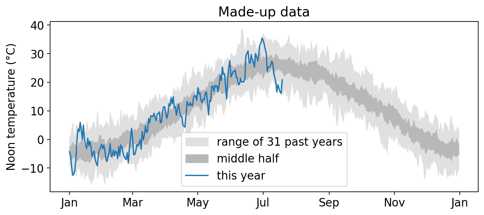
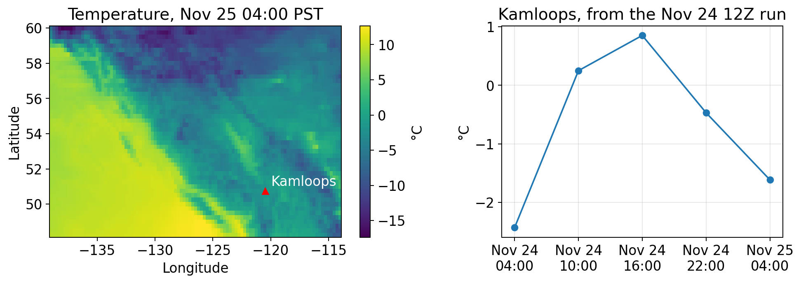
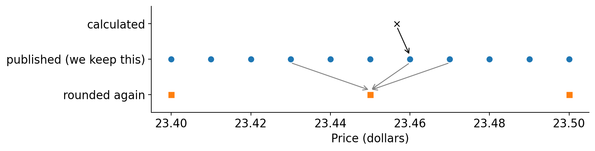

<!-- _paginate: false -->

# Weather data storage

Moving weather data from Postgres to object storage

November 2026

<!--
Everything here is running in development. Production has not been moved yet.
-->

---

## Why

- Postgres got too big to keep much history
- Older model data was archived and removed every month
- Object storage is cheap enough that we can keep it

Two parts to the work:

1. Weather at stations: observations, forecasters' forecasts and model values
2. Model forecasts as maps covering all of BC (new)

<!--
Archived data could not be looked at without restoring it.
The maps mean a forecast can be looked up at any location, not only at a station.
-->

---

## What is different

| | Before | Now |
|---|---|---|
| Model data | The last few months | Every run, from now on |
| Observations | Since our own job started collecting them | Hourly, back to 1987 |
| Model forecasts | At weather stations only | At stations, and as maps of BC for five models |
| New stations | No model history | History from the maps, from November 2026 |
| Updated WF1 forecasts | Only the latest was kept | Every version we receive is kept |

<!--
The five models are HRDPS, RDPS and GDPS (Canadian), GFS (American) and ECMWF (European).
-->

---

## Where the data is

| Data | Comes from | Stored in | Used by |
|---|---|---|---|
| Station observations and forecasts | WF1, BCWS data mart | Object storage | Climatology page, Station Weather API, adjusting model values |
| Model values at stations | Environment Canada, NOAA, ECMWF | Object storage | MoreCast, fire watch, Station Weather API |
| Model maps of BC | Environment Canada, NOAA, ECMWF | Object storage | Nothing yet |
| MoreCast forecasts | Forecasters | Postgres, as before | MoreCast |

<!--
The Station Weather API is how other teams can get the station data. They need a key.
The maps are not in the API yet.
-->

---

## Comparing a season with past years

The climatology page does this with the longer record. These temperatures are made up.

---

## Forecasts away from stations

A real GFS forecast, stored as a map. The plot on the right is read from it at the grid cell nearest Kamloops.

<!--
It could be any other location in BC. Only the first day of the run is shown.
-->

---

## Accuracy

We store the published values without rounding them again.

Rounding twice is like only having nickels: 23.43, 23.46 and 23.47 all become 23.45.

<!--
The forecast centres round once, before publishing. What we read back is what they published.
Some services, such as Open-Meteo, round a second time to save space.
-->

---

## How long we keep the maps

Every run for 48 hours, then one run a day, kept.

HRDPS at the end of a Saturday:

| Day | Runs kept |
|---|---|
| Saturday | 4 of 4 |
| Friday | 4 of 4 |
| Thursday and earlier | 1 a day |

<!--
Each run covers much of the same period as the one before, so keeping every run would mostly be storing the same days over again.
The one we keep is the last full-length run of the day.
-->

---

## Space and cost

| | Per year, five models |
|---|---|
| Original files, one run a day | about 1 TB |
| BC only, every run | about 200 GB |
| **BC only, what we keep** | **about 52 GB** |

- About \$44 a year for each year of maps, at 7 cents per GB per month
- Deleted maps stay on the storage for 60 days. That is an estimated \$27 a year more, if we are billed for it

<!--
The cost is for the maps only. It does not include the station data.
-->

---

## When something fails

- A job that is stopped part way is continued by the next one, without storing anything twice
- If a forecast centre is down, runs already downloaded are still published and the rest are tried again
- A map run is only stored once all of it has been published
- On November 23 one HRDPS map store stopped accepting data for about 12 hours and held up the other. They are now independent. We don't know yet why it stopped

<!--
Station data can be read as it was at any point in the last 30 days. For the maps it is about one day.
-->

---

## Status at November 23

**Working in development:** station data from the models, observations back to 1987, climatology page, Station Weather API, HRDPS and RDPS maps

**Added November 23:** GDPS, GFS and ECMWF maps

**Still to do:**

- copy production's history over and switch production
- a way to view the maps
- find out why the HRDPS store stopped

<!--
Some fixes to the station model jobs went in on November 23 and we are watching them.
The new maps were checked against the published data but not yet over several days.
MoreCast and fire watch should work as before. The old database tables stay until production's history has been copied and checked.
-->

---

## Appendix: how a value is stored

$$\text{value} = \frac{R + X \cdot 2^E}{10^D}$$

| | Price | Temperature near Kamloops |
|---|---|---|
| $R$, where counting starts | 2000 pennies | 22924.369 |
| $X$, steps above the start | 346 | 4229 |
| $2^E$, size of a step | 1 penny | 1 |
| $10^D$, steps in one unit | 100 pennies in a dollar | 100 |
| value | 23.46 dollars | 271.53369 K |

<!--
X is stored for every grid cell. R, E and D are stored once per forecast hour.
-->
