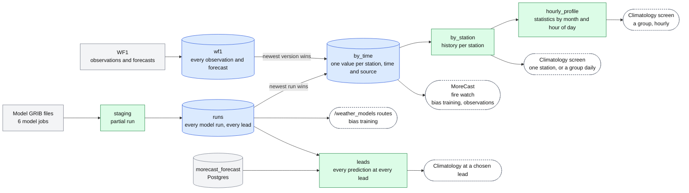

# Station weather data on object storage: layout diagram

The design is described in [station-predictions-storage.md](station-predictions-storage.md).

Data flows from left to right, from raw to derived. Blue cylinders are Delta Lake tables, green boxes are plain Parquet files, grey nodes are outside this design, and dashed nodes are readers.

`runs` and `wf1` are the only permanent records; everything to their right can be deleted and rebuilt. The nightly job writes `by_station`, `hourly_profile` and `leads`. Run bookkeeping has no box because it has no storage of its own: a run's state is read from what exists in `staging` and `runs`.
