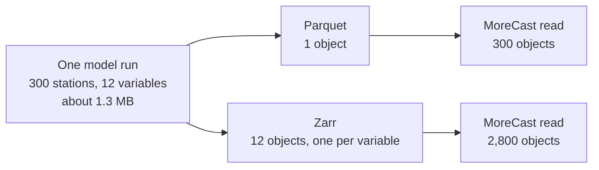
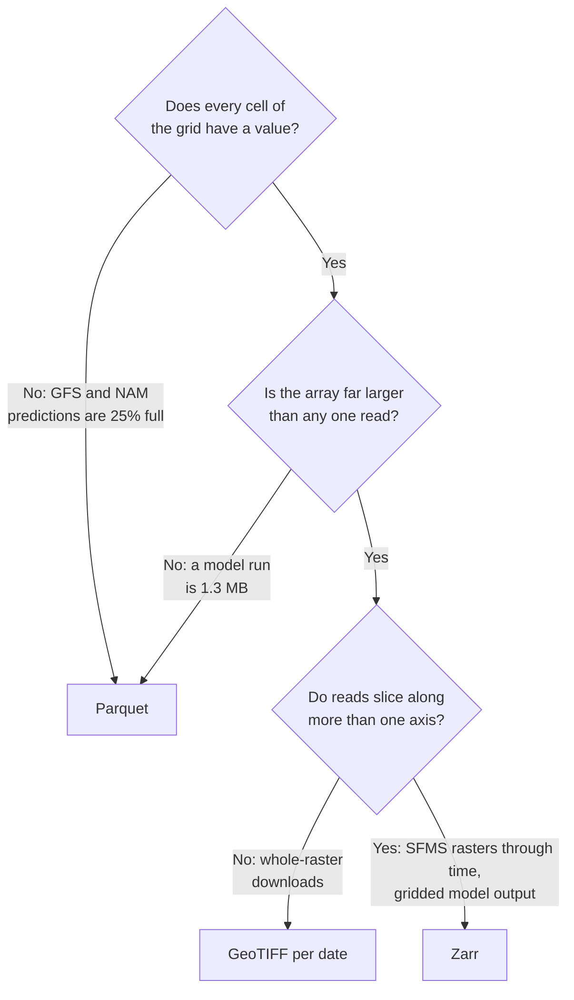

# Station weather data on object storage: evaluation

This is the evidence behind the design in [station-weather-storage.md](station-weather-storage.md): four local benchmarks, a comparison of the storage tools we considered, and a list of what was and was not verified.

All benchmarks ran on local disk with synthetic data for an assumed 300 stations. Sizes and object counts carry over to object storage. Latencies do not, and on object storage the number of objects read matters more than local read time. The floats are random at full precision, so sizes are an upper bound.

| Benchmark | Question | Script |
|---|---|---|
| [Formats](#benchmark-formats) | Which of Parquet, GeoParquet, Delta Lake, Zarr and Icechunk suits model runs? | `backend/scripts/station_predictions_storage_benchmark.py` |
| [Station history](#station-history-benchmark) | Does station history need one layout or two? | `backend/scripts/station_history_storage_benchmark.py` |
| [Leads](#lead-benchmark) | Do reads at a chosen lead need a second layout? | `backend/scripts/station_leads_storage_benchmark.py` |
| [Long reads](#reads-over-5-10-and-30-years-for-a-screen) | Can a screen compute climatology on demand over 30 years? | `backend/scripts/station_climatology_read_benchmark.py` |

The datasets named here (`runs`, `by_time`, `by_station`, `leads`, `hourly_profile`, `wf1`) are defined in the design.

## Benchmark: formats

`backend/scripts/station_predictions_storage_benchmark.py` writes the same synthetic predictions to all five formats and times the reads our code makes. Run it with:

```bash
uv run backend/scripts/station_predictions_storage_benchmark.py --days 60 --stations 300
```

The data follows the six models' real run cadence and forecast hours, including the interpolated 20:00 UTC rows. The results below are for 60 days and an assumed 300 stations: 18.6 million rows in 1,200 model runs.

Layouts tested:

| Format | Layout |
|---|---|
| Parquet | One file per run, under `model=…/run_date=…/`, sorted by station then prediction time. |
| GeoParquet | The same, with each station's point geometry on every row. |
| Delta Lake, runs table | One append per run, partitioned by model and run date. |
| Delta Lake, daily table | The 20:00 UTC row per station and day, updated by `MERGE` after each run. |
| Zarr | One group per model, one array per variable with dimensions (run, step, station), one chunk per run. |
| Icechunk | The same arrays, one commit per run. |

Storage and writes:

| Format | Size | Objects | Bytes per row | Write per run |
|---|---|---|---|---|
| Parquet | 1.53 GB | 1,200 | 82 | 6 ms |
| GeoParquet | 1.55 GB | 1,200 | 83 | 11 ms |
| Delta Lake, runs table | 1.63 GB | 2,413 | 88 | 39 ms |
| Delta Lake, daily table | 11 MB live, 1.22 GB on disk before `vacuum` | 2,413 | n/a | 51 ms |
| Zarr | 1.22 GB | 14,491 | 66 | 54 ms |
| Icechunk | 1.32 GB | 33,819 | 71 | 38 ms |

Reads, as median milliseconds with the number of objects read in brackets:

| Format | MoreCast: 20:00 UTC, 5 days, all stations, all models | 5 stations, HRDPS, 15-day window, all runs | Training: RDPS, 19 days, raw values | One RDPS run |
|---|---|---|---|---|
| Parquet | 129 (300) | 58 (48) | 68 (96) | 25 (4) |
| GeoParquet | 127 (300) | 60 (48) | 69 (96) | 24 (4) |
| Delta Lake, runs table | 279 (196) | 224 (46) | 231 (91) | 203 (1) |
| Delta Lake, runs table, after `optimize` | 123 (64) | 82 (12) | 88 (23) | 74 (1) |
| Delta Lake, daily table | 7 (6) | n/a | n/a | n/a |
| Zarr | 438 (2,800) | 85 (552) | 69 (455) | 10 (12) |
| Icechunk | 850 (2,800) | 168 (552) | 165 (455) | 21 (12) |

Each Delta read opens the table cold, so its figures include replaying the transaction log. The Zarr and Icechunk reads fetch whole-run chunks, so their window queries read somewhat more data than the Parquet ones.

## Which tool for the job

| Tool | Verdict | Why |
|---|---|---|
| Parquet | Yes, as the file format throughout | The data is a table keyed by station, run and prediction time, and every reader filters on those columns. It was the fastest and simplest in the benchmark. Delta Lake tables are Parquet files underneath. |
| Delta Lake | Yes, for the tables jobs write to | It gives several jobs safe writes to one table, and compaction. The costs are real: a cold open took about 200 ms of log replay locally, the daily `MERGE` left 1.2 GB of dead files behind 11 MB of live data in 60 days, so `vacuum` and `optimize` are required chores, and it brings its own S3 client. |
| GeoParquet | No | No reader makes a spatial query. Repeating a station's point on every row added 1.3% in size and doubled write time for no read benefit. |
| Zarr | No | A (run, step, station) cube works, but GFS, NAM and the interpolated 20:00 UTC rows have irregular steps that become NaN padding. It is 20% smaller because it stores no key columns, but it needs 12 times the objects, and "latest run per day" has to be written by hand in Python. |
| Icechunk | No | It is Zarr plus versioning. Runs are never rewritten, so "as of" is a filter on run time. It produced 28 times the objects of Parquet and depends on conditional writes, which are untested on ECS. |

Plain Parquet won the format benchmark on speed and simplicity, and would be enough if every table had one writer. We chose Delta Lake for `runs` and `by_time` anyway, because we want several writers per table and managed compaction. The costs in the table above are the price, and the [design](station-weather-storage.md#design) says how each is handled.

## Where Zarr would be the right tool

Zarr lost here because station predictions are a keyed table. It is the right tool when the data is a dense, regular N-dimensional array and readers want small slices of it along more than one axis.

The conditions that make Zarr win:

- **Every cell on the grid has a value.** Zarr stores no keys: position in the array is the key. That is why it was 20% smaller in the benchmark, and why the irregular GFS and NAM steps hurt, since missing cells become NaN padding.
- **Reads slice across axes.** "One pixel through time" and "one time step across space" can both be cheap from the same store, because the chunk shape is a choice. Parquet can only be sorted one way, and a GeoTIFF per date is only cheap for the whole-map read.
- **The array is far larger than any one read.** Chunking pays off when a reader wants kilobytes out of gigabytes. A run file here is 1.3 MB, so there is nothing to skip.
- **Readers already think in arrays.** With `xarray`, selecting by coordinates is the query, and no "latest run per station" logic has to be rebuilt in Python.

Where that applies in this project:

| Data | Fit | Why |
|---|---|---|
| SFMS rasters as a time series (FFMC, DC or HFI at a point over a season) | Strong | It is a dense (time, y, x) cube. A six-month point series opens about 180 GeoTIFFs today; with weekly time chunks it would read about 27 chunks. |
| Hourly FFMC | Strongest | The same shape with 24 times the time steps: about 4,400 rasters for six months today. |
| Gridded model output, if we ever keep it | Strong | It is a dense (run, step, y, x) cube per model. It would allow forecasts at any location and backfilling a new station, which station-only storage cannot do. |
| Station predictions | Weak | Sparse, irregular steps, small, and every query is a key filter. |
| Whole-raster downloads | Weak | A chunk layout tuned for time series scatters one date across every chunk. Cloud-optimized GeoTIFFs stay better here. |

The SFMS read counts are calculated from the grid dimensions and a chunk layout, not measured.

Costs that come with Zarr:

- **Object count.** Zarr writes one object per chunk per variable. It produced 12 times the objects of Parquet in the benchmark, and on object storage, latency follows request count.
- **Appends rewrite chunks.** Adding a date rewrites every chunk that covers it, so longer time chunks mean cheaper reads but costlier writes.
- **No transactions.** A reader can see a half-written append. Icechunk exists to fix that and adds versioning, which is where it earns its place: asking what a pixel's series looked like as of a past date. Whether Icechunk works against ECS is untested.

### Why station predictions miss those conditions

**The grid has holes.** A Zarr array needs one slot for every forecast hour that any run of the model can have. GFS keeps only the hours around noon, and noon falls at a different forecast hour for each run time, so each run fills a different quarter of the slots. This is the first day of the GFS forecast-hour axis as the benchmark stored it (■ is a value, · is NaN padding):

```text
forecast hour    0   2   3   6   8   9  12  14  15  18  20  21
00:00 UTC run    ·   ·   ·   ·   ·   ·   ·   ·   ·   ■   ■   ■
06:00 UTC run    ·   ·   ·   ·   ·   ·   ■   ■   ■   ·   ·   ·
12:00 UTC run    ·   ·   ·   ■   ■   ■   ·   ·   ·   ·   ·   ·
18:00 UTC run    ■   ■   ■   ·   ·   ·   ·   ·   ·   ·   ·   ·
```

The pattern repeats for each later day. Parquet writes only the ■ cells, as rows.

How full each model's array was in the benchmark:

| Model | Cells holding a value | Why cells are empty |
|---|---|---|
| HRDPS, RDPS | 100% | Every run has every hour. |
| GDPS | 90% | The interpolated 20:00 UTC rows fall at different forecast hours for the 00:00 and 12:00 runs. |
| ECMWF | 88% | The same. |
| GFS, NAM | 25% | Only the hours around noon are kept, as shown above. |

**One run becomes many objects.** Zarr writes one chunk object per variable, and the benchmark stores 12 variables. The read counts are for the MoreCast query in the [formats benchmark](#benchmark-formats).



**Which data suits Zarr.** The conditions above, as a decision path, with this project's data at the ends:



Station history is the exception: it is dense and regular, and Zarr was 36% smaller there. It still lost, for the reasons in the [station history benchmark](#station-history-benchmark).

### Could we change how we store the data so Zarr fits?

There are two ways. Only the second gives Zarr a real advantage.

| | Reshape the station data | Store the model grids |
|---|---|---|
| What changes | Stack the variables into one (run, step, station, variable) array per model, and move the interpolated 20:00 UTC rows into their own (day, station, variable) array. | Keep each model's grid as a (run, step, y, x) cube instead of sampling it at stations and discarding it. |
| What it fixes | One object per run instead of twelve, and no NaN padding in the main cube. GFS and NAM would still need an index axis, because they only keep the hours around noon. | The data becomes a dense cube far larger than any one read, which is the case Zarr is built for. |
| What it gains over Parquet | Nothing. Every read is still a key filter, a run is still 1.3 MB, and atomic appends still need Icechunk. | Station predictions become a point read. A new station can be backfilled, forecasts are available at any location, and bias adjustment can be recomputed from raw history. SFMS already consumes grids (`model_run_for_sfms`), so one store could feed both. |
| Size | Expected to be close to Parquet. Not measured. | Roughly 475 GB a year before compression for a BC-only crop of HRDPS alone, against about 9 GB a year measured for all six models' station data as float64. This is an order-of-magnitude estimate; the real grid dimensions have not been checked. |
| Verdict | Not worth doing. | The version worth doing, but a separate and much larger project that needs sizing first. |

Bias-adjusted values and the MoreCast daily rows are derived per-station tables, so a small tabular output would remain in either case.

## Comparison with Open-Meteo

Open-Meteo serves point forecasts from gridded model output and publishes its storage design. Its design is for a different problem from ours, and where the two overlap it reaches the same answers. The description here comes from a written summary of that design. It was not checked against the Open-Meteo repositories ([open-meteo](https://github.com/open-meteo/open-meteo), [om-file-format](https://github.com/open-meteo/om-file-format), [open-data](https://github.com/open-meteo/open-data)).

What Open-Meteo does:

- **It stores grids, not stations.** Each variable is a (latitude, longitude, time) array in its own OM format, which is close to Zarr: compressed chunks that can be read one at a time with ranged requests.
- **It chunks for the point read.** A chunk holds a few neighbouring grid cells and many time steps, so one location's forecast is a few small reads.
- **It keeps several copies.** One layout is for point time series, one for whole maps and one for single model runs.
- **It caches.** Hot chunks are kept on local disk, so repeat requests skip the object store.

Where it agrees with this design:

| Open-Meteo | This design |
|---|---|
| For a fixed set of stations, the summary recommends extracting station values once per run and storing them keyed by station, model, run and forecast time. Chunked grids pay off when users ask for arbitrary coordinates. | That is `runs`. No reader of ours asks for arbitrary coordinates. |
| A separate copy of the data for each read pattern. | `runs`, `by_time` and `by_station`. |
| Immutable per-run stores, and a rolling store shaped for queries. | `runs` is append-only. `by_time` is the copy that is updated. |

Where it applies to us is gridded data, which this document already rates a strong fit for Zarr: SFMS rasters as a time series, and model grids if we ever keep them. For those, its layout is the starting point: small spatial chunks with long time chunks for point reads, and a separate whole-raster layout for maps.

What it adds that this evaluation did not cover:

- **Zarr sharding.** Zarr 3 can pack many chunks into one object with an index, so a reader fetches byte ranges instead of whole objects. The formats benchmark did not use it. It weakens the object-count objection to Zarr, but only partly: sharding packs chunks within one array, so 12 variables are still at least 12 objects, and a shard that holds several runs is rewritten by each new run. The NaN padding and the key-filter reads are unaffected, so the verdict for station data stands. Any benchmark of SFMS rasters or model grids should include sharding.
- **A local cache.** The summary credits much of Open-Meteo's speed to caching, not to the file format. This design has no cache. Whether the climatology screen needs one depends on read times against ECS, which are not yet measured.
- **Quantized values.** Open-Meteo stores scaled integers, for example temperature to 0.1 degrees, and compresses the differences between neighbouring values. This design uses float32. Scaled integers in Parquet would be smaller. This was not tried, and is only worth it if size becomes a problem.

## Versioning

Choosing against Icechunk gives up less versioning than it appears to, because the history that matters for this data is in the data itself: every run is kept, and every row says which run it came from.

| Question | Plain Parquet files | Delta Lake | Icechunk |
|---|---|---|---|
| What did a given run predict? | Yes, if runs are never overwritten | Yes | Yes |
| What was the latest prediction as of a past time? | Yes, by filtering on run time | Yes, by filtering on run time | Yes, from a snapshot |
| What had actually been ingested by a past time? | Only with an `ingested_at` column | Yes, within the `vacuum` retention window, or permanently with an `ingested_at` column | Yes |
| What did a run look like before it was reprocessed? | Only if each version is kept as its own rows | The same, or by time travel within the retention window | Yes |
| Can the whole dataset be pinned, tagged or rolled back as one unit? | No | Partly: per table, by version number | Yes |

The design does not rely on any tool's versioning for the permanent record. `runs` and `wf1` are append-only, and each version of a run or an observation carries its own `ingested_at`. Delta time travel is a second, shorter safety net. See [Reprocessing history](station-weather-storage.md#reprocessing-history).

Icechunk's versioning matters more for the SFMS rasters. A chunk there is rewritten in place as new dates are added, so without snapshots the earlier values are gone.

## Indexing

None of these tools has an index in the Postgres sense. There is no B-tree and no secondary index that can be added after the fact. Each one offers a way to skip data instead, and it only works along the dimensions chosen when the data is laid out.

| Tool | What stands in for an index | What it can't do |
|---|---|---|
| Parquet | Min/max statistics per column in each file's footer, plus optional bloom filters. Partition paths (`model=…/run_date=…`) prune whole files. | Skip anything on a column the data isn't sorted or partitioned by. |
| Delta Lake | The same Parquet statistics, copied into the transaction log, so files are pruned without opening them. `optimize` with Z-ordering clusters files on several columns at once. | It prunes files, not rows. There is still no row-level or secondary index. |
| Zarr | Position is the index. A chunk's key is computed from its coordinates, so a read by (run, step, station) goes straight to the chunk. | Search by value: "where was temperature above 30" is a full scan. A lookup by label, such as a station code or a timestamp, needs the coordinate arrays loaded first. |
| Icechunk | Zarr's positional addressing, plus manifests that map each chunk to its object. | The manifest indexes chunks, not values. It adds nothing for lookups. |

What this means for `runs` in the design:

- **The partition is the index.** `runs` is partitioned by model and run date, so a reader goes straight to the files it needs. That covers every current reader of model runs.
- **Within a file, indexing is moot.** A run is 1.3 MB sorted by station, so reading the whole file costs about the same as skipping within it.
- **We lose the `station_code` index across time.** "One station over two years" would open every run file in the range, about 7,300 a year across the six models. Climatology needs exactly that read.

The fix is the same in every one of these formats: a second copy laid out for the read. In these formats, layout takes the place of an index. The `by_station` layout in the design is that second copy.

Zarr is a partial exception. With a station axis, one station across all runs is a cheap slice if the chunks are shaped for it, but chunks shaped that way make each new run rewrite existing chunks.

## Station history benchmark

`backend/scripts/station_history_storage_benchmark.py` writes the station history table, one value per station, time and source, in three layouts and times the reads:

```bash
uv run backend/scripts/station_history_storage_benchmark.py --years 5 --stations 300
```

| Layout | Description |
|---|---|
| `by_time` | Parquet, one file per source per month, all stations inside, sorted by time then station. |
| `by_station` | Parquet, one file per station per year, all sources inside, sorted by source then time. |
| Zarr | One (time, station, variable) array per source, in chunks of about a month by 25 stations. |

The results are for 5 years and 300 stations: 52.6 million hourly rows and 4.4 million daily rows, stored as float32.

| Layout | Hourly | Daily | Objects |
|---|---|---|---|
| `by_time` | 2.57 GB | 204 MB | 900 |
| `by_station` | 2.66 GB | 207 MB | 3,000 |
| Zarr | 1.63 GB | 136 MB | 11,042 |

Reads, as median milliseconds with the number of objects read in brackets:

| Read | `by_time` | `by_station` | Zarr |
|---|---|---|---|
| One station, hourly, all sources, all 5 years | 246 (420) | 1.6 (5) | 91 (427) |
| One station, daily, all sources, all 5 years | 109 (480) | 1.0 (5) | 84 (488) |
| 25 stations, hourly, 1 to 14 July of every year | 22 (35) | 35 (125) | 32 (49) |
| MoreCast: all stations, daily, 5 days, all sources | 1.7 (8) | 49 (300) | 23 (96) |

What this shows:

- **Each Parquet layout is the best at its own read by a wide margin**, and the worst at the other's. The object counts are what matter on object storage: 5 against 420 for a station's history, and 8 against 300 for MoreCast.
- **Zarr is a single copy that is never the best and never the worst.** It is 36% smaller. This is the one place a station dataset has the dense, regular shape Zarr wants.
- **Zarr's chunk shape could be tuned towards either read, but not both.** It also has the costs already described: every append rewrites the current chunk for each station block, and a reader can see a half-written append without Icechunk.

The two Parquet layouts together are about 1.1 GB a year. Storing the table twice is cheaper than serving either read badly, so the design uses both.

The design differs from what this benchmark wrote in two ways, both decided later. `by_time` is a Delta Lake table, not plain files, because several jobs write to it. `by_station` is one history file per station, not one per year, because of the long reads measured in [Reads over 5, 10 and 30 years, for a screen](#reads-over-5-10-and-30-years-for-a-screen).

## Lead benchmark

`backend/scripts/station_leads_storage_benchmark.py` tests whether reads at a chosen lead need two layouts, as the settled history does. Lead is how far ahead a prediction was made; see [Lead time](station-weather-storage.md#lead-time). It writes one year of every prediction at every lead in two Parquet layouts:

```bash
uv run backend/scripts/station_leads_storage_benchmark.py --stations 300
```

| Layout | Description |
|---|---|
| `leads_by_station` | One file per station per year, with one row group per model per month. |
| `leads_by_time` | One file per model per month, with one row group per station. |

A reader uses the statistics in each file's footer to fetch only the row groups it needs. On object storage each row group is one ranged GET.

To keep the run short it generates two models, HRDPS and GDPS: 39.2 million rows for 300 stations. Each layout is 2.08 GB, at 53 bytes per row.

| Read | `leads_by_station` | `leads_by_time` |
|---|---|---|
| One station, whole year, lead 18 to 30 hours | 1 file, 24 row groups, 6.9 MB, 3 ms | 24 files, 24 row groups, 6.9 MB, 51 ms |
| 25 scattered stations, 1 to 14 July, lead 18 to 30 hours | 25 files, 50 row groups, 14.6 MB, 18 ms | 2 files, 50 row groups, 14.6 MB, 11 ms |
| 25 scattered stations, 1 to 14 July, every lead | 25 files, 50 row groups, 14.6 MB, 17 ms | 2 files, 50 row groups, 14.6 MB, 10 ms |

What this shows:

- **Both layouts fetch exactly the same row groups and bytes.** Because the row groups are cut by station, model and month in each, the only difference is how many files hold them.
- **For one station, the station-keyed layout is far better**: one object, which can be fetched whole, against one file per model per month.
- **For a group, the two are close.** The cost is one ranged GET per station, model and month either way. Extrapolated to six models, the 25-station read is about 175 requests station-keyed (25 footers and 150 row groups) against about 156 time-keyed (6 footers and 150 row groups).
- **Either is much better than reading `runs`.** The same two-model group read from `runs` would open about 112 run files and fetch over 100 MB to use a fraction of it. That figure is calculated from the run cadence, not measured.

So a second, time-keyed copy with leads is not worth its 6 GB a year. One station-keyed copy with well-cut row groups serves both shapes. The settled history is different: its files are small enough to fetch whole, and MoreCast reads every station at once, so it keeps both layouts.

## Reads over 5, 10 and 30 years, for a screen

Climatology has to serve a screen someone waits on, for one station or a group, over 5, 10 or 30 years. History starts when this is built, so a 30-year read is decades away, but the layout has to hold up as the years accumulate.

The choice is between precomputing statistics and computing them on demand from raw history. Precomputing freezes the period, the statistic, the smoothing window and the grouping, which are the things we want to stay flexible. So the test is whether raw history can be made cheap enough to read that the API can compute on demand.

`backend/scripts/station_climatology_read_benchmark.py` tests that:

```bash
uv run backend/scripts/station_climatology_read_benchmark.py --years 30
```

It writes one history file per station holding every year, sorted by source then time, with one row group per source per year. One source's whole history is then a single contiguous byte range: one request for the footer and one for the data. It fetches the data and computes percentiles with `numpy` and `pandas`. The group is 25 stations.

| Read | 5 years | 10 years | 30 years |
|---|---|---|---|
| One station, daily, all sources, percentiles by day of year | 1 request, 0.8 MB, 0.07 s | 1 request, 1.6 MB, 0.09 s | 1 request, 4.7 MB, 0.18 s |
| Group, daily, one source, per-station and pooled percentiles by day of year | 50 requests, 1.5 MB, 0.3 s | 50 requests, 2.9 MB, 0.4 s | 50 requests, 8.7 MB, 1.0 s |
| One station, hourly, one source, percentiles by month and hour of day | 2 requests, 1.5 MB, 0.01 s | 2 requests, 3.0 MB, 0.01 s | 2 requests, 9.0 MB, 0.03 s |
| Group, hourly, one source, pooled percentiles by month and hour of day | 50 requests, 37 MB, 0.1 s | 50 requests, 75 MB, 0.2 s | 50 requests, 225 MB, 0.7 s |

The times are local read, decode and compute. They exclude the network, which on object storage will dominate.

What this shows:

- **Three of the four reads suit a screen at every horizon.** Request counts do not grow with the years, the data fetched stays under 10 MB, and the statistics take a second or less to compute.
- **Hourly data for a group is the exception.** It fetches 75 MB at 10 years and 225 MB at 30. The computation is fast; the download is the problem.
- **No statistics table is needed for the other three.** The API computes whatever the screen asks for, and can cache results, since closed years never change.

For hourly group reads, the design adds one small derived table, `hourly_profile`: the count, mean, minimum and maximum of each variable per station, source, year, month and hour of day. That is 288 rows per station, source and year against 8,760 raw, so about a thirtieth of the size. Counts, means and extremes combine exactly across any years and any group. Percentiles do not, so a pooled hourly percentile for a group over decades stays an offline read. `hourly_profile` has not been benchmarked.

Reads at a chosen lead follow the same pattern once the rule is stored as its own source. Before that, they go through `leads`, which holds every lead and is about ten times larger: 100 MB for one station over 5 years and 600 MB over 30. Experimenting with leads on a screen is practical for one station over a few years, and a batch job beyond that.

## What is and isn't verified

**Checked:**

- The tables, queries and readers described in the design, read on `main` as of 2026-11-12.
- The figures from the four benchmarks, each from one local run with `deltalake` 1.6.6, `icechunk` 2.3.1, `zarr` 3.4.2 and `pyarrow` 26.0.1.
- Conditional PUTs on ECS: the check script passed against our object store on 2026-11-12.

**Not checked:**

- **Several Delta Lake writers on ECS.** Checked on 2026-11-16 with `backend/scripts/object_store_delta_check.py`, using `deltalake` 1.6.6 with the storage option `conditional_put: etag`. Four processes each appended ten times to one table at once: all 40 commits succeeded and the table ended at version 40, so none was lost. `MERGE`, `optimize` (40 files to 1), a checkpoint and `vacuum` all worked. This is evidence, not proof: the writers shared one machine, the table was tiny, and the run was done once. The store had already passed `backend/scripts/object_store_conditional_put_check.py` on 2026-11-12.
- **Which mode the earlier Delta Lake trial used.** If it ran with the unsafe-rename option, it showed only that a single writer works.
- **Delta Lake for `by_time` at full size.** The format benchmark ran `MERGE` on a small daily table only. `by_time` with hourly data and the maintenance job have not been benchmarked.
- **One Delta table for both history layouts.** Delta's Z-ordering might let a single table serve MoreCast and climatology. It was not tried; the design keeps the measured two-layout approach.
- **Latency against ECS.** The only timings so far are from the Delta Lake check on a tiny table: a cold open took 839 ms and a filtered read 71 ms (median of 5). The cold open is about four times the local figure, on a table with a fresh checkpoint, which suggests a fixed cost per open (connection setup and a few requests), not log replay. That reading is untested. No real read path has been timed. The `/weather_models` path, which reads the most files per request, is the one to time first.
- **MoreCast read parity.** On 2026-11-16, `backend/scripts/morecast_by_time_parity_check.py` compared MoreCast's model read from `by_time` with the same read from Postgres in a dev deployment: 6,936 values for 320 stations over 14 days, with no differences. This also shows `MERGE` working against ECS. The `by_time` read took 1.16 s from a laptop, including opening the table. The Postgres read took 24.81 s, but through a port-forward and one query per day, so it is not a fair comparison. The deployment held only the runs ingested since it was created, so the sample is small.
- **Station count.** The benchmarks assume 300. The dev deployment had 320 on 2026-11-16. Size and row counts scale linearly with it.
- **Real sizes.** At 300 stations, `runs` is about 113 million rows a year. The benchmark measured 82 bytes per row as float64, about 9 GB; the 4.5 GB float32 figure is half of that, not measured. Station history is about 11 million rows a year, or about 0.55 GB per layout as float32. Real values should compress better than random floats.
- **`hourly_profile`.** It has not been benchmarked. Its size is estimated from its row count.
- **Network time for the climatology reads.** The climatology benchmark measured local read and compute only.
- **The nightly rebuild.** Rebuilding every station's current-year file each night, and merging a year into the history files, have not been timed.
- **How observations arrive.** The WF1 job that writes `hourly_actuals` was not read in detail, including how far back each fetch reaches. That decides how many rows each fetch has to compare before appending to `wf1`.
- **The bookkeeping replacement.** The current lifecycle was read from the call sites in the model jobs, not traced end to end. Listing a `staging` prefix, reading its footers and checking `runs` for a run have not been timed against ECS. The staging file counts per run are calculated from the forecast-hour ranges, assuming one GRIB per variable per hour.
- **Hourly forecasts.** They do not exist in the code today. Where they will come from, and whether MoreCast will record their history as it does for daily forecasts, is not known.
- **Dependencies.** Neither `pyarrow` nor `deltalake` is a declared dependency of any backend package. `deltalake` 1.6.6 and `pyarrow` 26.0.1 installed and ran on top of the backend environment for the check, but they have not been added to the lock file, and whether the production images install them cleanly has not been checked.
- **Open-Meteo's design.** The [comparison](#comparison-with-open-meteo) rests on a written summary, not on the Open-Meteo repositories. Zarr sharding, a read cache and quantized values were not benchmarked.
- **Other layouts.** Each format was tested with one layout. Different Zarr chunking or Delta partitioning would move the numbers, though not the object-count gap or the log-replay cost.
